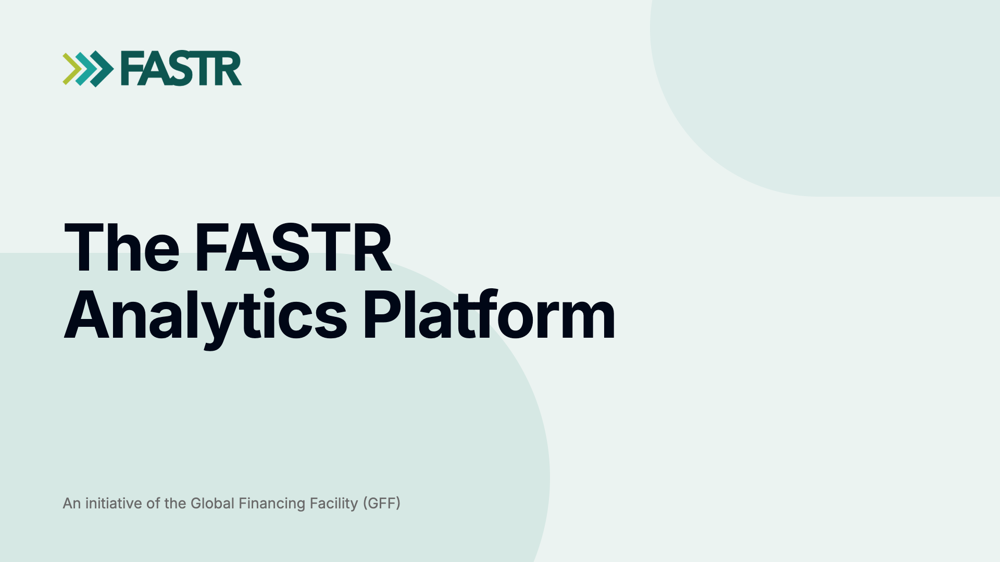
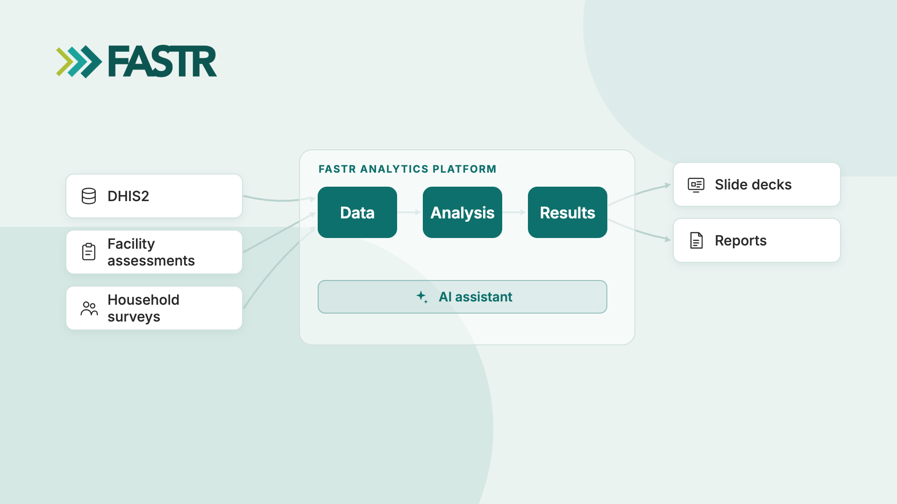
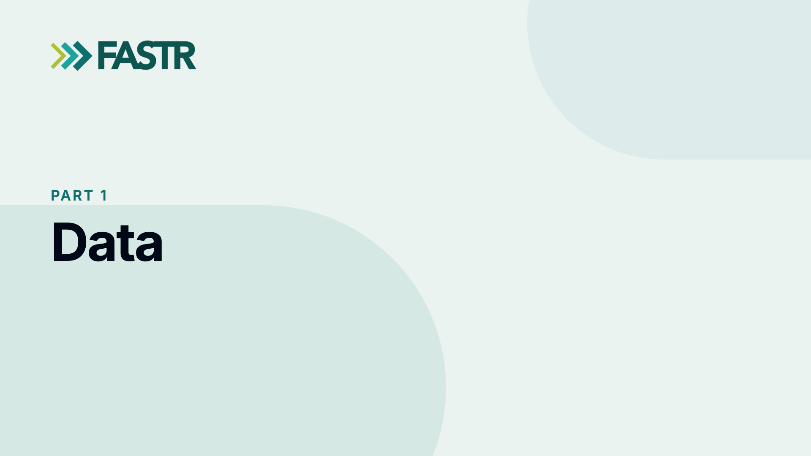
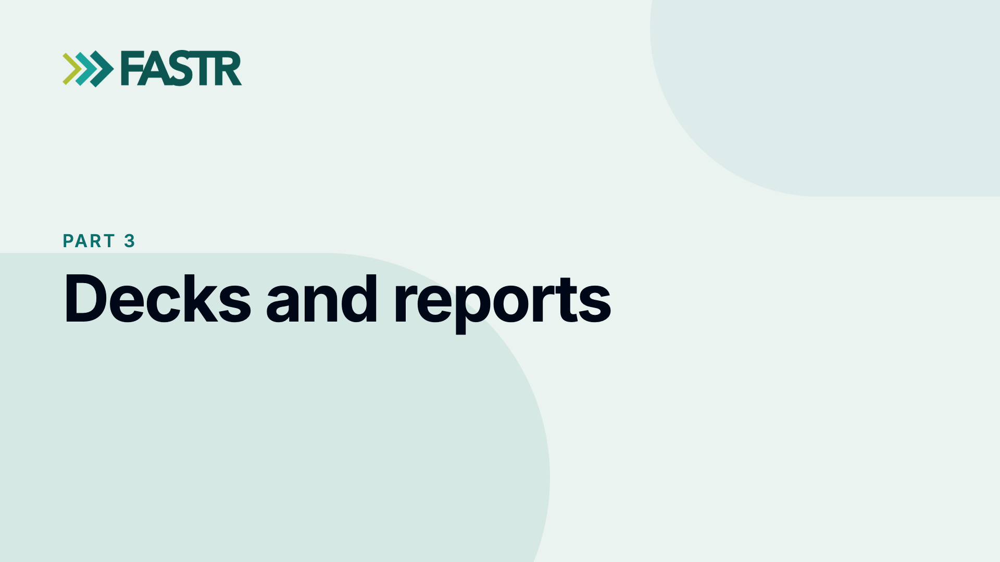
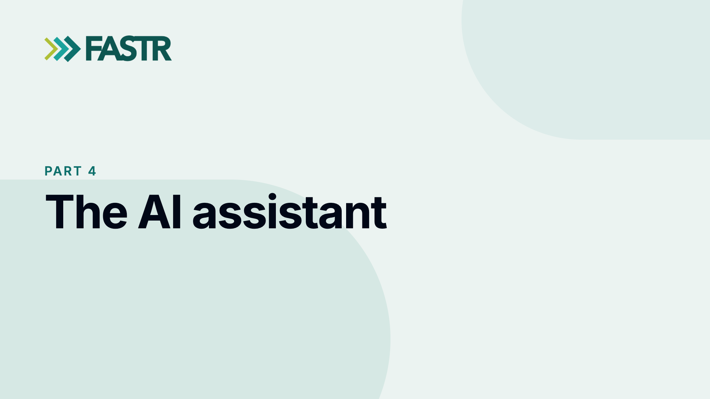
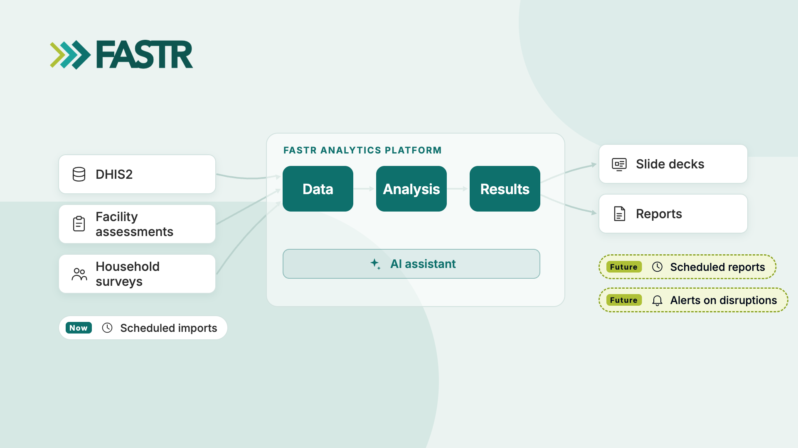
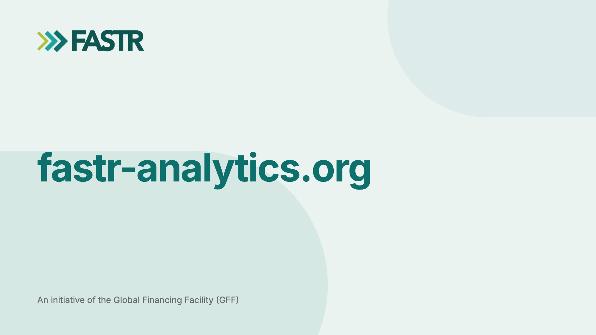

# The FASTR Analytics Platform: demo video transcript (v2)

Headings are the title cards. The italic line under each heading is the
suggested screen content, not narration.

## Title card

_Screen: the title card for the first sentence, then the schematic (today
version) from the second sentence: the three sources, the three stages, decks
and reports, and the AI assistant appear roughly as they are named._

_Video: [schematic_v1.mp4](schematic_v1.mp4) (today)_

In this video, I'm going to show you the FASTR Analytics Platform, which we've
built for collaborative analysis of health systems data, and for quick and easy
generation of reports. I'm going to show you how you can import data from
different sources, such as DHIS2, health facility assessments and household
surveys, and how you can run analysis modules on that data and use the results
to create slide decks and reports. And I'm going to show you how you can use the
built-in AI tools to interpret results, write text, and compile a slide deck
from scratch.

## Part 1: Data

_Screen: the Users page, then the Data page: a DHIS2 import choosing indicators
and a period, then an HFA upload._

To begin with, you can set up a platform by specifying the country and adding
users with different levels of permission. You can then start to import data
from different sources. For example, you can import HMIS data directly from a
DHIS2 instance. To do this, you enter your credentials, choose the indicators
you want to import, and for which period of time. You can also import other
sources of data, for example health facility assessment data and household
survey data.

## Part 2: Analysis

_Screen: the results package wizard with the module list, a run in progress,
then the Explore tab._

Once you've imported data, you can run the analysis modules. There are different
modules that let you do things like run data quality adjustments on routine
data, run regression analysis to identify disruptions in service delivery,
estimate coverage, and calculate facility readiness indicators from HFA data.
The modules follow the FASTR methodology, and they take a few minutes to run.
We've also built the platform to allow for custom analyses, so new and different
analyses can be added over time. After you've run one or more modules, you can
then visualize the results of those analyses. Each module comes with a set of
default tables and figures, or you can create your own.

## Part 3: Decks and reports

_Screen: the deck editor: adding a slide, dropping in a figure, choosing a
theme, downloading; a report; the out-of-date badge and Update figures; two
cursors editing one deck; version history._

Next, you can bring together the results of your analysis in a report. One type
of report you can make is a slide deck. Similar to working in PowerPoint, you
can create slides and then add visualizations from your results to the slides.
The figures and tables automatically resize, making it very simple to add
content and lay out slides. You can download the deck as a PowerPoint or PDF
file, or write a longer report and download it as a Word document.

Importantly, if the data in the platform is updated, you can update all the
figures, allowing you to create, for example, a regular monthly report. A report
can be seen and edited by multiple users, so a team can work together on a
report similar to a Google Doc or a SharePoint file. Every version of the report
is saved, so you can go back to an earlier version if you need to.

## Part 4: The AI assistant

_Screen: the chat beside a deck; a question answered from the results; a figure
preview added to the deck; a deck built from a topic, slide by slide; the prompt
library._

Now I'm going to show you the AI features of the platform and how you can use AI
to generate visualizations and reports. Across the entire platform, there is an
AI assistant that knows which part of the platform you're working in, and which
can answer questions by looking at results from your analyses. You can ask it
questions directly, such as, did antenatal care service delivery improve in the
past year? Or you can ask it to create figures and tables, and to interpret
those figures and tables.

Perhaps the most useful function of the AI is that you can ask it to pull
together different results from across your modules to create a coherent report
that has a narrative arc to it, with different sections and key messages. If you
give the AI a topic, it will look at all the available results on that topic and
will review each of those results in detail. It will create a report outline and
start to populate the report with different figures and accompanying text. As
the AI is building the report, you can give it direction, asking it to expand on
certain findings or fine-tune the text. You can also work on the report together
with the AI by editing slides yourself. The AI will see the edits you've made
and complement your efforts.

To make using the AI even easier, we've added a built-in prompt library to the
platform. So rather than writing out long instructions, you can select a prompt
from the library, and this will give the AI detailed instructions on how to
generate a report and to quality check its own work.

## Part 5: Guardrails

_Screen: the assistant's data tool call expanded to show the results it read; a
report edit proposed as a diff; the delete confirmation; version history with
the AI's edits._

I want to stress that the AI doesn't make up its own numbers or run its own
analysis. Rather, it works with the results of the analysis modules that have
been thoroughly vetted by the FASTR team. This increases the reliability and
consistency of the AI. When the AI edits a report, it shows you the changes
first, and you can accept or reject them.

## Part 6: Automation

_Screen: the schematic (future version) through the whole paragraph: scheduled
imports, scheduled reports and alerts appear as they are named. Then the end
card._

_Video: [schematic_v2.mp4](schematic_v2.mp4) (future)_

Finally, you can set the platform to import data from DHIS2 automatically, for
example every month. In the future, we plan to extend this to scheduled
reporting, so that when new data arrives, the analysis is re-run and the reports
are updated and sent out. We also plan to have the AI look at new data as it
arrives and send an alert if it detects a disruption.

We are really excited about these features of the platform. We're continually
expanding and improving them with the goal of building a robust analysis and
reporting system that is as useful as possible for country teams. Thank you.

